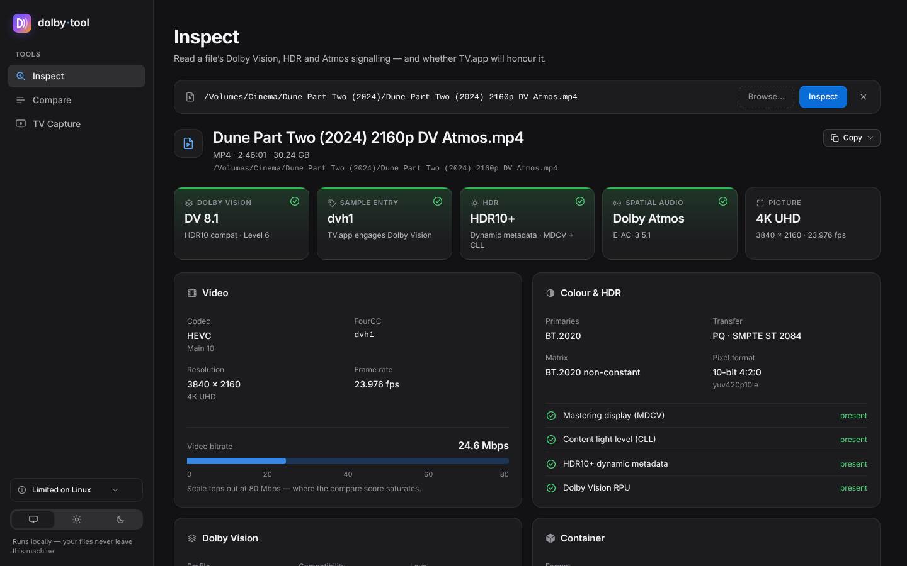
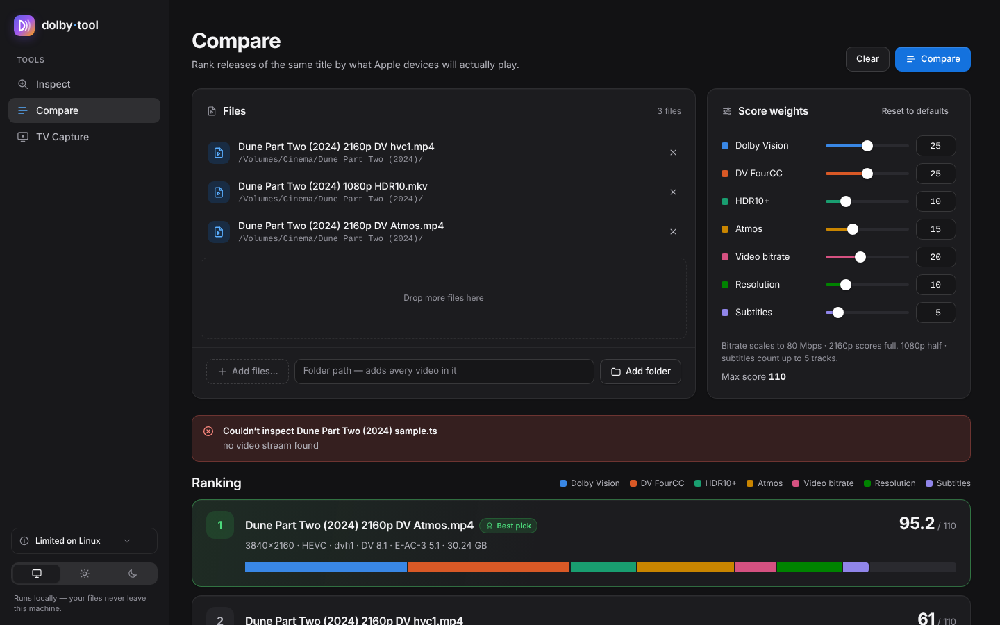
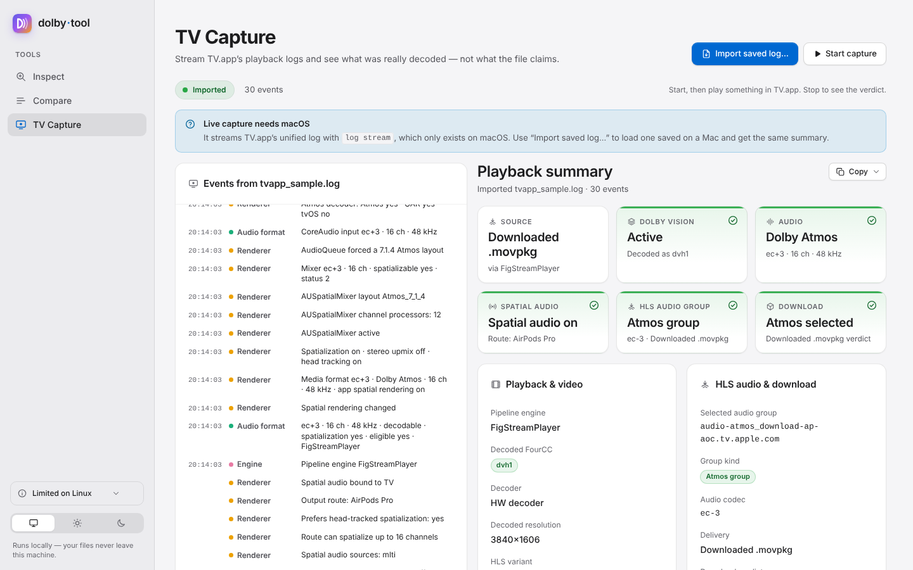
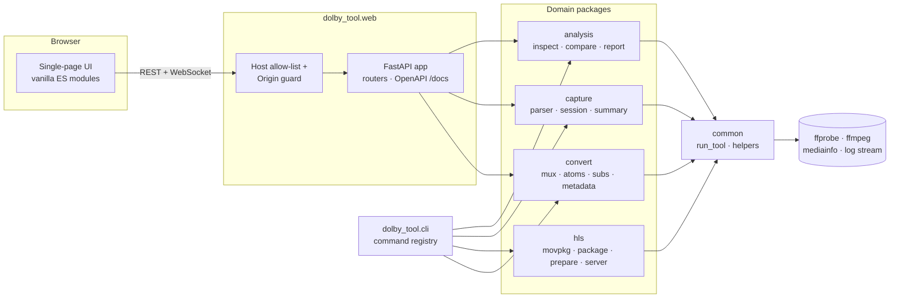

<div align="center">

# dolby·tool

**Inspect Dolby Vision, HDR and Atmos media — and see what Apple TV.app actually plays.**

[](https://github.com/plxzy/Dolby/actions/workflows/ci.yml)



<br><sub>Inspect view with sample Dolby Vision 8.1 + Atmos data · dark theme</sub>

</div>

## Why

Apple TV.app silently falls back from Dolby Vision to plain HDR10 when an MP4's
video sample-entry FourCC is `hvc1` instead of `dvh1`/`dvhe` — even when a valid
`dvvC` configuration box is present. Diagnosing that means juggling `ffprobe`
side data, `log stream` predicates and HLS manifests. **dolby·tool** puts all of
it behind one local web UI and a scriptable CLI.

## Features

| | |
|---|---|
| **Inspect** | Dolby Vision profile & compatibility (5 / 7 / 8.1 / 8.2 / 8.4), sample-entry FourCC with a TV.app breakage warning, HDR10 mastering display / content light level, HDR10+, every audio track (codec, channels, layout, bitrate, Atmos/JOC), subtitles (default / forced / SDH), container stats. |
| **Compare** | Ranks several releases with a weighted score (DV, FourCC, HDR10+, Atmos, bitrate, resolution, subtitles), stacked score bars per component, per-dimension winners and adjustable weights. |
| **TV Capture** | Summarises what TV.app *actually* played. Administrators get the macOS unified log: DV profile, hardware decoder FourCC, audio format, channels, spatialisation, HLS audio group, bitrate. Every account, admin or not, also gets system evidence: hardware decode (codec, coded size, bit depth, DRM), HDR/EDR presentation, audio output, measured download rate, Now Playing title and opened media files. Saved logs can be imported on any OS. |
| **Convert / Tag** | Remux a local file to `.m4v`, optionally add Apple TV metadata, or tag an existing file or season folder. Replace episode cover art with a shared season image. |
| **CLI** | Everything above as scriptable commands with Markdown or JSON output, plus `.movpkg` inventory, local fMP4 HLS packaging/serving and an MKV → Apple-TV `.m4v` converter. |

<table>
<tr>
<td></td>
<td></td>
</tr>
</table>

## Quick start

Requirements: macOS, [uv](https://docs.astral.sh/uv/) (`curl -LsSf https://astral.sh/uv/install.sh | sh`)
and FFmpeg (`brew install ffmpeg`). Optional: `mediainfo` for richer Atmos detection,
`AtomicParsley` and `bdsup2sub` for the converter.

```bash
./dolby-tool              # start the UI and open Safari at http://localhost:7878
./dolby-tool stop         # stop it
./dolby-tool --help       # list all commands
```

uv installs Python 3.14 and the locked dependencies on first run.

## Command line

| Command | What it does |
|---|---|
| `dolby-tool [serve] [--host H] [--port N]` | Start the web UI (loopback only by default). |
| `dolby-tool inspect FILE [--json]` | Dolby Vision / HDR / Atmos / track report for one file. |
| `dolby-tool compare FILE… [--weight KEY=N] [--json]` | Score and rank several files. |
| `dolby-tool tvlog-capture [--profile tv\|local-player] [--seconds N]` | Capture playback (macOS): unified log when admin, system evidence always. |
| `dolby-tool tvlog-parse LOG [--json]` | Summarise a saved `log stream --style compact` capture. |
| `dolby-tool movpkg PKG` / `movpkg-scan DIR` | Inventory downloaded TV.app `.movpkg` packages (audio groups, completeness, verdict). |
| `dolby-tool hls-package FILE OUT` | Stream-copy a local file into fMP4 HLS with Apple-friendly master tags. |
| `dolby-tool hls-serve DIR [--open quicktime]` | Serve an HLS folder with HTTP byte ranges on loopback. |
| `dolby-tool hls-prepare PKG OUT` | Flatten a persisted-HLS `.movpkg` into a servable folder. |
| `dolby-tool hls-package-capture FILE OUT` | Package, serve, open QuickTime and capture logs in one go. |
| `dolby-tool convert IN.mkv OUT.m4v` | Remux MKV → Apple-TV-ready `.m4v` (+ optional Apple TV metadata). |
| `dolby-tool tag FILE_OR_DIR [--season-artwork IMAGE]` | Write Apple TV metadata or replace artwork in one file or every immediate `.mp4`/`.m4v` in a folder. |
| `dolby-tool browser-build [--out DIR]` | Build the static browser inspector (Inspect and Compare, files read on-device) into `dist/browser`. |

`uv run dolby-tool …` and `uv run python -m dolby_tool …` work too.

## Convert MKV → Apple TV

`dolby-tool convert` stream-copies an MKV (or MP4) into an Apple-TV-ready `.m4v` — no re-encode.

The **Convert** view exposes conversion and in-place tagging without uploading files.
Metadata lookup is off by default for web conversions; enable it to search the Apple
TV catalogue. Existing conversion outputs are preserved unless **Overwrite** is selected.
The same workflows are available at `POST /api/convert` and `POST /api/tag`; see `/docs`
for their request fields.

```bash
dolby-tool convert "Movie (2024).mkv" "Movie (2024).m4v"            # interactive Apple TV metadata lookup
dolby-tool convert in.mkv out.m4v --no-metadata --json             # just the remux, machine-readable summary
dolby-tool tag "Severance S01E01.m4v" --non-interactive            # tag an existing file in place
dolby-tool tag "Season 1" --season-artwork poster.jpg --json       # replace art on immediate MP4/M4V files
```

- **Video** is tagged `hvc1` (Apple players reject FFmpeg's default `hev1`); Dolby Vision
  profile 5/8 sources are written as `dvh1` with their `dvcC` box. Profile 7 (dual-layer
  Blu-ray) is not playable on Apple devices — the base layer is kept and the summary says so.
- **Audio** keeps every track Apple can play from MP4 (E-AC-3/Atmos, AC-3, AAC, ALAC, FLAC,
  MP3, Opus) and lists skipped ones (TrueHD, DTS, PCM) under `audio_skipped`; E-AC-3 is
  preferred as the default track, commentary/AD tracks never are.
- **Subtitles**: text tracks become `mov_text`; PGS is converted to VobSub when
  [`bdsup2sub`](https://github.com/mjuhasz/BDSup2Sub) is installed; others are reported in `subs_skipped`.
- **Metadata** (optional) comes from the Apple TV catalogue for any storefront
  (`--storefront GB`), including artwork and content ratings, and is written with
  [AtomicParsley](https://github.com/wez/atomicparsley).
- **Season artwork:** catalogue season art is preferred over show and episode artwork
  when Apple publishes it. `tag FILE_OR_DIR --season-artwork IMAGE` replaces all cover
  images with the local image; without `--metadata-id` or `--show`, it skips catalogue
  lookup entirely. Folder tagging is non-recursive and modifies the media in place.
- Expert knobs: `--colr-from-source` / `--colr-*` patch the `colr` box in place;
  `--experimental-force-dec3-joc` only patches a `dec3` box that already reserves the JOC
  extension bytes and otherwise reports why it can't.

## Architecture



```
dolby_tool/
├── cli.py            command registry (`dolby-tool …`)
├── common.py         shared helpers: run_tool/ToolError, ffprobe_json, coercion
├── analysis/         inspect (ffprobe → typed MediaSpec), compare (scoring), report (Markdown)
├── capture/          predicates, parser (log line → event), session (LogCapture), summary, system (non-admin sampler)
├── hls/              movpkg inventory, fMP4 packaging, .movpkg flattening, Range server
├── convert/          MKV → .m4v mux, MP4 box patching, PGS subtitles, Apple TV metadata
└── web/              FastAPI app factory, routers, security guards, static/ frontend
tests/                mirrors the packages; ffmpeg-generated clips via a shared fixture
harness/, reports/    research harness (Swift/dtrace) and notes on the TV.app spatial-audio gate
```

Design notes:

- **Typed core.** `inspect_file()` returns a Pydantic `MediaSpec`; the same models
  drive the JSON API, the OpenAPI docs at `/docs` and the CLI's `--json`.
- **One subprocess boundary.** Every external tool goes through `common.run_tool`
  (timeouts, detached stdin, lenient decoding, `ToolError` with the tool's last
  stderr line).
- **Loopback by design.** The server can read any local path, so it rejects
  foreign `Host` headers (DNS rebinding) and cross-origin WebSocket/POST requests.
- **No frontend build step.** Plain HTML, CSS custom properties (light/dark
  themes) and ES modules; data is rendered with DOM APIs, never `innerHTML`.

## Development

```bash
uv sync                      # create the venv (Python 3.14) with dev tools
uv run pytest                # test suite (ffmpeg-backed tests skip if ffmpeg is missing)
uv run ruff check .          # lint
uv run ruff format .         # format
uv run dolby-tool --reload   # UI with auto-reload
```

CI runs lint, format check and the full test suite on every push and pull
request; Dependabot keeps `uv.lock` and the GitHub Actions up to date.
Real-media fixtures set encoder colour signalling explicitly; the MP4 colour-box
fixture also sets frame colour properties and requests `write_colr`, rather than
depending on FFmpeg-version-specific defaults.

### Browser inspector

`dolby-tool browser-build` writes a static site to `dist/browser`: Inspect and Compare
in browser mode, an on-device analysis worker (`static/js/browser/`, tested with
`node --test tests/js/`), vendored mediainfo.js (integrity-checked npm tarball,
cached in `~/.cache/dolby-tool/`) and a `_headers` file with the CSP and
`frame-ancestors` for psporidis.com. It is served by the assets-only Cloudflare
Worker in `wrangler.jsonc` at https://dolby.psporidis.com; deploy manually with
`uv run dolby-tool browser-build && npx wrangler deploy`.

Browser Compare accepts two or more files through the picker or drop zone, with no
uploads or backend API calls. It uses the native comparison weights and scoring
rules; the same editable weights are remembered locally. Unresolved evidence
contributes its possible minimum–maximum points, never an assumed zero. Ranking
stays **Provisional** while any file is unfinished or any score is a range.
Overlapping (including touching) ranges have no decided order; a best pick needs
strictly separated ranges, or fully resolved scores (ties share best).

Only one comparison worker runs at a time, including during a pause, to bound
memory and CPU. Each file keeps the inspector’s automatic 512 MiB / 30-second
pause and **Continue deeper** increments (2 GiB / 120 seconds). Continue or stop a
paused file to advance the queue. Unsupported, stopped, or exhausted checks can
leave permanent ranges; “not seen” does not mean “No”. The `?embed=1` edition starts
on Inspect and provides an in-page Inspect / Compare switch. Its authenticated
host pause/resume messages control both views, including queued comparisons.

## Notes

- Binding to all interfaces (`--host 0.0.0.0` or `--host ::`) keeps browser origins restricted
  to loopback. To use the UI over your LAN, explicitly trust its full origin (scheme, host and port):
  `DOLBY_TOOL_ALLOWED_ORIGINS=http://192.168.1.20:7878 ./dolby-tool --host 0.0.0.0`.
  Multiple trusted origins can be comma-separated. A specific `--host 192.168.1.20` also trusts
  that host. Only use these network modes on a trusted network: the tool accesses local files.
- Files are referenced by path, never uploaded — videos are too large. Drag from
  Finder, paste a path, or use the native picker.
- Drag-and-drop resolves names via Spotlight first and falls back to `find(1)`
  over `/Volumes` and common folders (covers external drives Spotlight skips).
- `log stream` only runs for administrators (macOS refuses it for standard
  accounts, as do Console and `xctrace`). On a standard account TV Capture skips it
  and collects system evidence only (`ioreg` decoder sessions, EDR headroom,
  `pmset` assertions, `nettop`, `lsof`, MediaRemote). That evidence cannot tell
  Dolby Vision from HDR10 or show the HLS variant and Atmos decisions; run as an
  admin for those.
- The Now Playing helper (`capture/nowplaying.m`) is compiled with `clang` on first
  use into `~/Library/Caches/dolby-tool/` and loaded into `/usr/bin/perl`. Without
  the Command Line Tools, that one field is left out.
- TV Capture works retroactively: start capture, play in TV.app, then stop.
